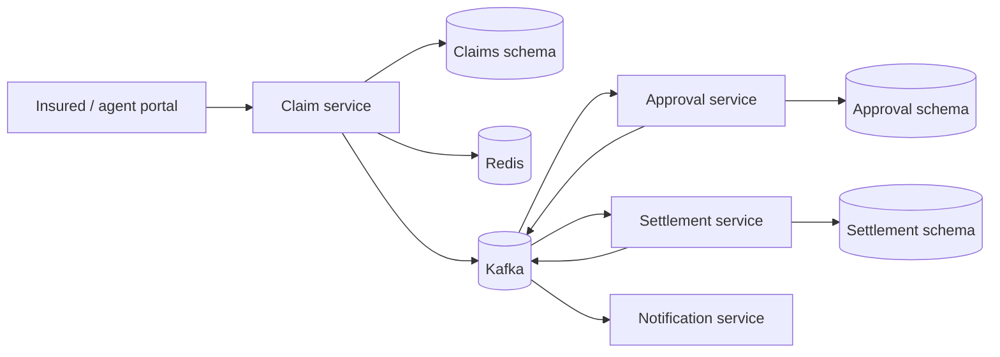

# Insurance Claims Management System

[](https://github.com/Hvmanker/insurance-claims-management-system/actions/workflows/ci.yml)

Spring Boot microservices implementation for claim submission, approval, settlement, and notification workflows.

Repository owner **[Hvmanker](https://github.com/Hvmanker)** maintains this codebase for the InsureFlow auto-claims demo (see [ADR-001](todos/architecture-decisions/ADR-001-extend-existing-repo.md)).

## Architecture



- `claim-service` exposes REST APIs for claim submission and lookup, persists claims in PostgreSQL, caches claim reads in Redis, and publishes `claim.submitted` Kafka events.
- `approval-service` consumes submitted claims, applies an auto-approval rule, records the decision, and publishes approved or rejected events.
- `settlement-service` consumes approved claims, creates an idempotent settlement record, and publishes settlement events.
- `notification-service` consumes workflow events and logs notification work.
- `common` contains shared event contracts and topic names.

## Tech Stack

- Java 21
- Spring Boot
- Spring Web, Spring Data JPA, Spring Kafka, Spring Data Redis
- PostgreSQL with Flyway migrations
- Redis caching
- Apache Kafka event streaming
- Docker Compose

## Run Locally

You need Docker (and Docker Compose). `docker compose up --build` compiles every service inside the multi-stage image build, so a host JDK or Maven install is not required for the container stack.

For IDE work or running tests on the host, install Java 21 and Maven:

```bash
mvn clean verify
```

After the package/groupId rename to `com.hvmanker.insurance`, run `mvn -U clean install` once so your local `~/.m2` does not resolve outdated cached modules.

Copy environment variables from the example file, set strong passwords for the required variables, then start the infrastructure and services:

```bash
cp .env.example .env
# Edit `.env` and replace placeholder passwords before starting the stack.
# `.env.example` DEMO_* values are placeholders only—they do not meet portal password rules (length 12–72, upper, lower, digit). Replace every DEMO_*_PASSWORD with your own values that satisfy those rules before enabling the `demo` profile, or the seeder will fail and you cannot sign in with the example strings.
docker compose up --build
```

**Optional demo users:** By default the `demo` Spring profile is off (`SPRING_PROFILES_ACTIVE` is empty in `.env.example`). To seed legacy portal accounts at startup, opt in explicitly in your `.env`:

```bash
SPRING_PROFILES_ACTIVE=demo
# All nine variables below are required when `demo` is active (one per seeded persona; see fixture `passwordEnv` fields).
DEMO_ADJUSTER_PASSWORD=replace-with-strong-demo-adjuster-password
DEMO_ADMIN_PASSWORD=replace-with-strong-demo-admin-password
DEMO_AGENT_PASSWORD=replace-with-strong-demo-agent-password
DEMO_AUDITOR_PASSWORD=replace-with-strong-demo-auditor-password
DEMO_BROKER_PASSWORD=replace-with-strong-demo-broker-password
DEMO_FINANCE_PASSWORD=replace-with-strong-demo-finance-password
DEMO_INSURED_PASSWORD=replace-with-strong-demo-insured-password
DEMO_SIU_PASSWORD=replace-with-strong-demo-siu-password
DEMO_SUPERVISOR_PASSWORD=replace-with-strong-demo-supervisor-password
```

Demo portal users (when the profile is active) include legacy agent `agent@insureflow.local` and insured `insured@insureflow.local`. Persona definitions (email, role, and `passwordEnv` property names—never password values) live in `claim-service/src/main/resources/fixtures/personas/`; broker–insured link metadata is under `fixtures/personas/links/`. Both are packaged on the claim-service classpath. Use only the `DEMO_*` values from your `.env` file—never commit real passwords. Without the `demo` profile, `portal_users` stays empty until someone registers through the portal.

**One-time database reset:** migration `V2__add_portal_accounts_and_claim_reason.sql` no longer inserts demo users (they are seeded by the `demo` Spring profile from environment passwords). If you previously ran this project against an existing Postgres volume, reset once so Flyway can re-apply the changed migration:

```bash
docker compose down -v
docker compose up --build
```

Open the secure insurance portal (host port **8081** is `claim-service` until the Phase 1D API gateway):

```text
http://localhost:8081/dashboard
```

Create an insured member account, sign in, and submit a claim from the portal. The form requires a claim reason and the claim is visible only to its owner.

Passwords created through the portal are stored as BCrypt hashes; use a secret manager and SSO/MFA in a production deployment.

The protected API can also be exercised with a session cookie. A claim request now requires a reason:

```bash
curl -X POST http://localhost:8081/claims \
  -H 'Content-Type: application/json' \
  -d '{
    "policyNumber": "POL-10045",
    "claimType": "AUTO",
    "reason": "Collision damage after another vehicle entered my lane.",
    "estimatedAmount": 7250.00
  }'
```

Look up a claim by the returned `id`:

```bash
curl http://localhost:8081/claims/{claimId}
```

Claims at or below `AUTO_APPROVAL_LIMIT` are approved automatically and flow to settlement. Higher-value claims stay in `SUBMITTED` until a legacy `AGENT` user records a manual decision in the portal.

## Test the Workflow

1. Start the stack with `docker compose up --build`.
2. Create an insured member account and submit an Auto or Home claim below `$10,000` with a reason.
3. Wait a few seconds for Kafka processing. The claim's status should change from `SUBMITTED` to `SETTLED`.
4. Submit a claim above `$10,000` and sign in as the legacy `AGENT` demo user (with `SPRING_PROFILES_ACTIVE=demo`) to approve or reject the manual-review queue item.
5. Check the claim-service health endpoint:

```bash
curl http://localhost:8081/actuator/health
```

## Continuous Integration

GitHub Actions runs the approval-policy unit tests, compiles every Maven module on Java 21, and validates the complete Docker Compose build for each push and pull request.

## Local access

Docker Compose publishes only **claim-service** on host port **8081** (approval, settlement, notification, and data stores are reachable on the internal Compose network). A single public entry point via Spring Cloud Gateway is planned in Phase 1D.

## Notes

The services use one PostgreSQL database for local development, with each data-owning service isolated in its own schema and managing that schema through Flyway migrations. A production deployment can split these schemas into separate databases.

`claim-service` owns the portal authentication boundary. It uses Spring Security sessions, BCrypt password hashing, and role-aware access: only **INSURED** (own claims) and the legacy **AGENT** (all claims) are active today. **BROKER**, **ADJUSTER**, **SUPERVISOR**, **SIU**, **FINANCE**, **AUDITOR**, and **ADMIN** exist since slice 0.6 but are inert—they see no claims, get 404 on get, and 403 on decide until later phases grant access.
