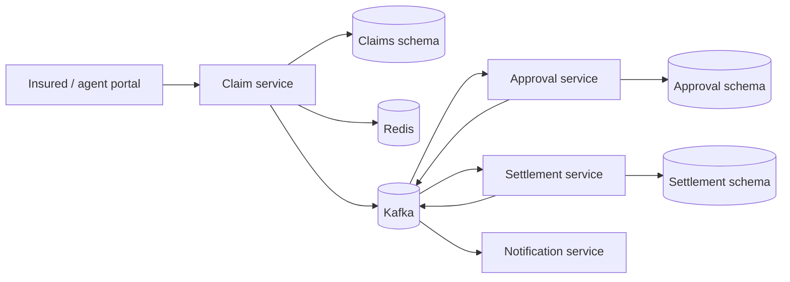

# Insurance Claims Management System

[](https://github.com/sunilguntupalli/insurance-claims-management-system/actions/workflows/ci.yml)

Spring Boot microservices implementation for claim submission, approval, settlement, and notification workflows.

## Architecture



- `claim-service` exposes REST APIs for claim submission and lookup, persists claims in PostgreSQL, caches claim reads in Redis, and publishes `claim.submitted` Kafka events.
- `approval-service` consumes submitted claims, applies an auto-approval rule, records the decision, and publishes approved or rejected events.
- `settlement-service` consumes approved claims, creates an idempotent settlement record, and publishes settlement events.
- `notification-service` consumes workflow events and logs notification work.
- `common` contains shared event contracts and topic names.

## Tech Stack

- Java 21
- Spring Boot
- Spring Web, Spring Data JPA, Spring Kafka, Spring Data Redis
- PostgreSQL with Flyway migrations
- Redis caching
- Apache Kafka event streaming
- Docker Compose

## Run Locally

Install Java 21, Maven, and Docker, then build the service jars:

```bash
mvn clean package
```

Copy environment variables from the example file, then start the infrastructure and services:

```bash
cp .env.example .env
# Edit `.env` and replace placeholder passwords before starting the stack.
docker compose up --build
```

**One-time database reset:** migration `V2__add_portal_accounts_and_claim_reason.sql` no longer inserts demo users (they are seeded by the `demo` Spring profile from environment passwords). If you previously ran this project against an existing Postgres volume, reset once so Flyway can re-apply the changed migration:

```bash
docker compose down -v
docker compose up --build
```

Open the secure insurance portal:

```text
http://localhost:8085/dashboard
```

Create an insured member account, sign in, and submit a claim from the portal. The form requires a claim reason and the claim is visible only to its owner.

With `SPRING_PROFILES_ACTIVE=demo` (see `.env.example`), demo portal users are seeded at startup: legacy agent `agent@insureflow.local` and insured `insured@insureflow.local`. Use the `DEMO_AGENT_PASSWORD` and `DEMO_INSURED_PASSWORD` values from your `.env` file. Without the `demo` profile, `portal_users` stays empty until someone registers through the portal.

Passwords created through the portal are stored as BCrypt hashes; use a secret manager and SSO/MFA in a production deployment.

The protected API can also be exercised with a session cookie. A claim request now requires a reason:

```bash
curl -X POST http://localhost:8081/claims \
  -H 'Content-Type: application/json' \
  -d '{
    "policyNumber": "POL-10045",
    "claimType": "AUTO",
    "reason": "Collision damage after another vehicle entered my lane.",
    "estimatedAmount": 7250.00
  }'
```

Look up a claim by the returned `id`:

```bash
curl http://localhost:8081/claims/{claimId}
```

Claims at or below `AUTO_APPROVAL_LIMIT` are approved automatically and flow to settlement. Higher-value claims are rejected with a manual-review reason.

## Test the Workflow

1. Start the stack with `docker compose up --build`.
2. Open `http://localhost:8081/dashboard`, create an insured member account, and submit an Auto or Home claim below `$10,000` with a reason.
3. Wait a few seconds for Kafka processing. The claim's status should change from `SUBMITTED` to `SETTLED`.
4. Submit a claim above `$10,000` to verify the rejection path.
5. Check the health endpoints:

```bash
curl http://localhost:8081/actuator/health
curl http://localhost:8082/actuator/health
curl http://localhost:8083/actuator/health
curl http://localhost:8084/actuator/health
```

## Continuous Integration

GitHub Actions runs the approval-policy unit tests, compiles every Maven module on Java 21, and validates the complete Docker Compose build for each push and pull request.

## Service Ports

- Claim Service: `8085` on the host (`8081` inside Docker)
- Approval Service: `8082`
- Settlement Service: `8083`
- Notification Service: `8084`
- PostgreSQL: `5432`
- Redis: `6379`
- Kafka: `9092`

## Notes

The services use one PostgreSQL database for local development, with each data-owning service isolated in its own schema and managing that schema through Flyway migrations. A production deployment can split these schemas into separate databases.

`claim-service` owns the portal authentication boundary. It uses Spring Security sessions, BCrypt password hashing, role-aware access (`INSURED` and `AGENT`), and claim ownership checks. Agents can review the full operational queue; insured members can only access their own claims.
