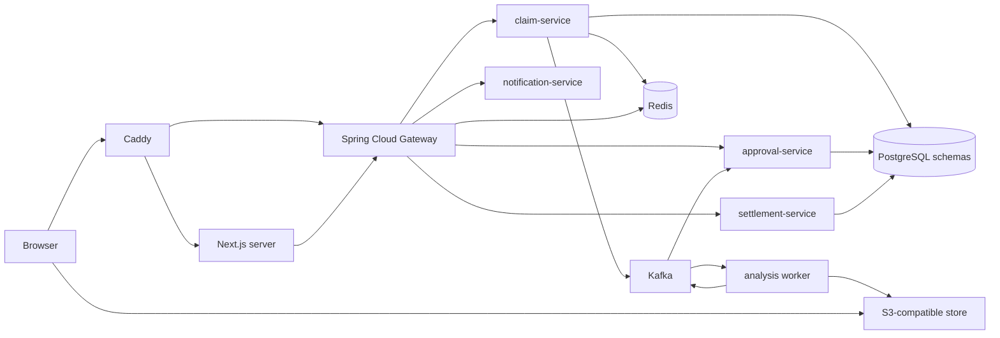

# Component architecture

Date: 2026-10-11
Status: accepted plan, stack rows are working assumptions
ADRs: [ADR-011](../architecture-decisions/ADR-011-schema-per-service-postgres.md), [ADR-013](../architecture-decisions/ADR-013-spring-cloud-gateway.md), [ADR-010](../architecture-decisions/ADR-010-nextjs-app-router-default.md)

## Who talks to whom

Caddy is the only public entry. It terminates HTTPS and forwards:

- pages to the Next.js server,
- API calls to Spring Cloud Gateway.

The gateway routes to the four Spring services. Postgres, Kafka, Redis, object storage, the AWS emulator, and service ports stay on a private Compose network. The Python worker is internal only. The browser uploads and downloads files with short-lived signed URLs aimed at the private bucket. File bytes do not pass through Kafka or PostgreSQL.

## Schemas

One PostgreSQL instance. Each service has its own schema and its own Flyway history. Chips under a service in the source diagram mean that schema. No service connects to another service's tables.

## Stateless services

HTTP sessions live in Redis (Spring Session) from slice 1, so a claim-service restart does not trap a user on one JVM. If Redis is down, sign-in fails with a clear unavailable message. Claim data is unaffected.

## What is new relative to Compose today

Today the browser talks to claim-service on port 8081, which also serves the portal. There is no Caddy, no gateway, and no Next.js container. Adding them is the slice 1 shell plus the slice 5 and slice 8 edge. Slice 1 can keep a temporary direct path for tests as long as the gate's browser journey uses the app shell the plan names.

## Memory

The gateway is another JVM. The Next.js server is another container. Both are in the 12 GB budget in [20-hosting-memory-and-public-demo.md](20-hosting-memory-and-public-demo.md).
